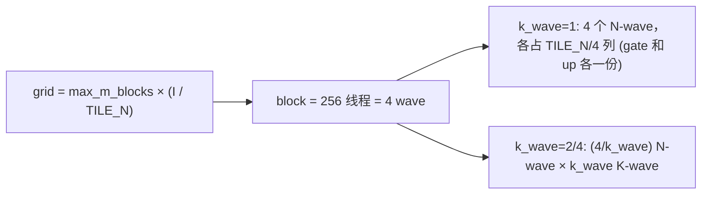
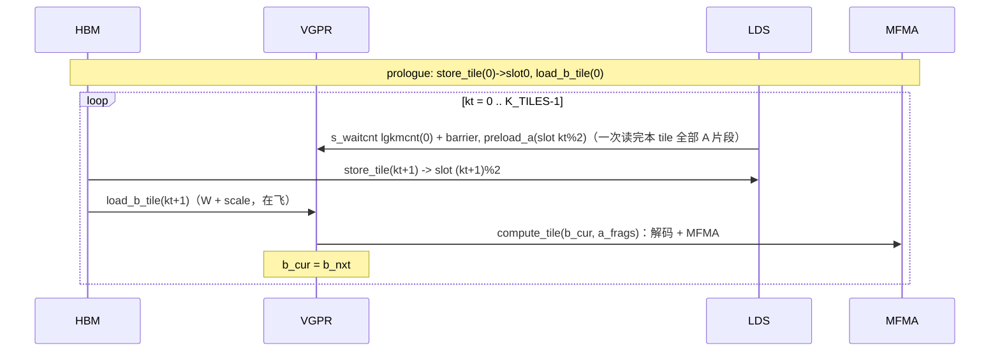

# compile_gemm1_a16w4_port 实现与优化原理分析

对象：[gemm1.py](aiter/ops/flydsl/kernels/moe_2stage_a16wmix/gemm1.py) 中的 `compile_gemm1_a16w4_port` / `_gemm1_body_a16w4`，以及它依赖的 [utils.py](aiter/ops/flydsl/kernels/moe_2stage_a16wmix/utils.py)（`make_a_loader` / `make_b_loader`）。分支：`tq/gfx942-a16w4-a8w4`。重点讨论 bf16 A × mxfp4 W（a16w4）在 gfx942（MI300X）上的路径；fp8r（A8W4）只在对比处提及。

数据以 MiMo-V2.6 TP8 为例：`model_dim(H)=6144`、`inter_dim(I)=256`、`E=384`、`topk=8`。

---

## 1. 功能定位

MoE 第一阶段（gate+up 融合 GEMM + 激活）：

```
inter[sorted_row, :] = act( A[token(sorted_row)] @ W1_gate[e]^T ) * ( A[token] @ W1_up[e]^T )
```

- A：bf16 `[tokens, H]`，按 `sorted_token_ids` 间接 gather，无 A scale。
- W1：mxfp4（E2M1，每 32 个 K 一个 e8m0 scale），`[E, 2I, H/2]`，标准 GGUU 预 shuffle 布局。
- 输出：bf16 中间结果 `[sorted_size, I]`，**按 sorted 位置存放**（不 scatter 回 token），stage2 直接按行连续读取，topk 加权和 scatter 留给 stage2。
- 激活：`silu` / `swiglu` / `situv2`，beta 等参数是运行时 f32 标量，不进编译 key。

## 2. 编译期参数与 kernel 名

`compile_gemm1_a16w4_port`（[gemm1.py#L465](aiter/ops/flydsl/kernels/moe_2stage_a16wmix/gemm1.py#L465)）被 `functools.cache` 缓存，所有影响代码生成的参数都是 Python 常量，在 trace 期间被 `const_expr` / `range_constexpr` 完全展开：

| 参数 | 含义 | 对代码的影响 |
|---|---|---|
| `BM` | M tile（sorted 行数，16 的倍数） | `m_repeat = BM/16`，每个 B 片段复用的 MFMA 次数 |
| `TILE_N` | inter 方向 tile（gate、up 各 `TILE_N` 列） | `num_acc_n = TILE_N/(4/k_wave)/16` |
| `TILE_K` | K tile | `k_unroll = TILE_K/32`，K tile 数 `H/k_wave/TILE_K` |
| `k_wave` | 块内 slice-K（1/2/4） | 4 个 wave 重新划分为 `(4/k_wave) N-wave × k_wave K-wave`，结束后 LDS 归约 |
| `b_cache_mod` | W 读取的 cache 修饰（0=cached，2=nt） | `BufferCopy128b(aux)` |
| `xcd_swizzle` | XCD round-robin + M 分组重映射 | 改变 block → tile 的映射 |
| `waves_per_eu` | `rocdl.waves_per_eu` 属性 | 约束 VGPR 用量以换取 occupancy |
| `k_loop` | `unroll`（默认）/ `runtime` | K 循环全展开 vs 运行时循环 |
| `w_dtype` / `w_layout` / `a_dtype` | fp4/int4/bf16 W；standard/guinterleave；bf16/fp8r A | 选择不同的 loader / 解码 / MFMA |

kernel 名 `gemm1_a16w4_port_{a16w4|a8w4}..._h{H}_i{I}_ne{E}_bm{BM}_tn{TILE_N}{_act}{_bcm}{_xcd}{_w}{_kw}...`（[gemm1.py#L613](aiter/ops/flydsl/kernels/moe_2stage_a16wmix/gemm1.py#L613)）。注意 `TILE_K` 不在名字里，但在 aiter 的 kernelName（`t{BM}x{TILE_N}x{TILE_K}`）里。

## 3. 并行划分



- **grid**：`max_m_blocks × NUM_N_BLOCKS`（[gemm1.py#L458](aiter/ops/flydsl/kernels/moe_2stage_a16wmix/gemm1.py#L458)）。按 padding 后的最大 m-block 数发射，实际有效 tile 数 `bound = cumsum0/BM × NUM_N_BLOCKS` 由 kernel 读 `cumsum[0]` 得到，越界 block 直接退出（几乎零开销）。
- **m-block → expert**：`e = sorted_expert_ids[m_block]`，用 `readfirstlane` 变成 SGPR 标量，后续 W 地址都是 wave 统一的。
- **gate/up 配对**：每个 wave 拥有的 N 列在 gate 半区和 up 半区（偏移 `INTER`）各取一份（`b_loader.col_pair(..., shift=INTER)`），因此 `act(gate)*up` 在寄存器里直接完成，不需要跨 wave 交换——这是 gate/up 融合的关键。

## 4. 数据通路

### 4.1 B（权重）通路：一个 lane 一次 dwordx4 = 32 个 fp4

W 预 shuffle 布局（[utils.py#L649](aiter/ops/flydsl/kernels/moe_2stage_a16wmix/utils.py#L649)）：

```
shape  (N/16, (K/2)/64, klane=4, nlane=16, kpack=16 B)
stride (k0*1024, 1024, 256, 16, 1)
```

- 每 128 个 K 为一个 `k0` 块；lane `L` 的 `klane = L/16`、`nlane = L%16`，读 16 B（32 个 fp4）。64 个 lane 恰好读连续的 1024 B，**完全合并访问**。
- 关键点：**A 和 B 使用相同的“置换后”K 映射**（[utils.py#L201](aiter/ops/flydsl/kernels/moe_2stage_a16wmix/utils.py#L201)）：lane L 在 K32 步 `ku` 覆盖的 K 元素是 `(ku//4)*128 + (L//16)*32 + (ku%4)*8 .. +8`。MFMA 内部的 K 归约顺序被置换了，但 A、B 置换一致，点积结果不变。好处是：
  1. 一个 lane 的 32 个连续 K 用一条 dwordx4 取到，覆盖 4 个 ku；
  2. 这 32 个 K 恰好是一个 mxfp4 scale group，**一个 lane 4 个 ku 共用一个 e8m0 scale**。
- scale 读取（[utils.py#L874](aiter/ops/flydsl/kernels/moe_2stage_a16wmix/utils.py#L874)）：每个 128-K 块每 lane 每列一次 32-bit 标量 buffer load（dict 缓存跨 ku 复用），再用移位从 4 个 e8m0 字节中挑出自己的（`k_pack_sub`、`n_pack` 选择）。

### 4.2 gfx942 上的 fp4 → bf16 解码

gfx942 没有 `v_cvt_scalef32_pk_bf16_fp4`（gfx950 专有），所以走查表解码（[utils.py#L449](aiter/ops/flydsl/kernels/moe_2stage_a16wmix/utils.py#L449)、[utils.py#L484](aiter/ops/flydsl/kernels/moe_2stage_a16wmix/utils.py#L484)）：

1. E2M1 的 8 种幅值在 bf16 中都能精确表示，把 bf16 的高字节、低字节分别放进两个 8 字节常量池；
2. `nibble & 7` 作为 `v_perm_b32` 的选择子，一条 perm 同时解出 4 个字节；sign 位（nibble bit3）移位后 OR 到高字节 bit7；
3. 再用 perm 把高低字节拼回 4 个 dword（每个 dword 2 个 bf16）；
4. 乘 scale：bf16↔f32 只是 16 位移位，每半个 dword 移到 f32 → 乘 e8m0 scale → 截断回 bf16。因为 scale 是 2 的幂，乘积精确，截断等价于舍入（gfx942 也没有 `v_cvt_pk_bf16_f32`）。

粗略指令数（每 8 个 fp4 → v8bf16）：选择子 3 + 幅值 perm 4 + sign 5 + 拼接 perm 8 + scale 4×7 ≈ **48 条 VALU**，其中 scale 部分约占 60%。

### 4.3 A（激活）通路：gather + LDS 双缓冲

`make_a_loader`（[utils.py#L221](aiter/ops/flydsl/kernels/moe_2stage_a16wmix/utils.py#L221)）：

- **gather**：每行的 token id 从 `sorted_token_ids` 低 24 位取出，乘以行跨度得到全局地址。
- **padding 行零开销屏蔽**：buffer resource 的 `num_records` 设为真实 `[tokens, H]` 大小，padding 行（sentinel token ≥ tokens）的读取被硬件钳位成 0，无需分支。
- **gfx942 的 LDS 写入**（[utils.py#L313](aiter/ops/flydsl/kernels/moe_2stage_a16wmix/utils.py#L313)）：CDNA3 的 buffer→LDS 直写只支持每 lane 4 B，无法得到 16 B/lane 的布局，因此经 VGPR 中转：`buffer_load_dwordx4` → `ds_write_b128`。gfx950 则用 `BufferCopyLDS128b` 直写。
- **LDS 布局**：`k_wave × A_LDS_STAGES × BM × TILE_K × 2B`，gemm1 默认线性（gemm2 用 XOR swizzle）。例：BM=32、TILE_K=256、双缓冲 → 32 KiB。
- **片段读取**：`ds_read_b128` 读出一个 v8bf16 MFMA 片段（行 = `lane%16 + mi*16`）。

### 4.4 MFMA

- gfx950：`MFMA(16,16,32,bf16)`，一个 K32 步一条。
- gfx942：没有 16x16x32 bf16，`_mma_bf16`（[utils.py#L192](aiter/ops/flydsl/kernels/moe_2stage_a16wmix/utils.py#L192)）把 v8bf16 拆成两个 v4bf16，发 **2 条 `MFMA(16,16,16,bf16)`** 累加到同一个 acc。吞吐相同（16x16x16 bf16 在 CDNA3 上 4 pass = 16 cycle）。
- 累加器：`acc_gate[m_repeat][num_acc_n]`、`acc_up[...]`，每个是 4×f32 的 rmem tensor，原地更新。

`compute_tile`（[gemm1.py#L299](aiter/ops/flydsl/kernels/moe_2stage_a16wmix/gemm1.py#L299)）的循环顺序是 `ni → ku → (解码 gate/up B 片段一次) → mi`，**每个解码出的 B 片段被 `m_repeat` 个 M 子块复用**。这一点决定了解码开销的摊薄程度（见第 6 节）。

## 5. K 循环与软件流水线

`k_loop="unroll"`（[gemm1.py#L356](aiter/ops/flydsl/kernels/moe_2stage_a16wmix/gemm1.py#L356)）：A-LDS 双缓冲 + 下一 tile 的 B 预取，所有 K tile 在 trace 期完全展开。



设计要点：

- **相位分离**：先把本 tile 的 A 片段全部读进寄存器，再发下一个 tile 的 A/B 读取，避免 ds_read 和 vmem 交错导致的 `vmcnt(0)` 排空；
- **单 barrier**：只等 `lgkmcnt(0)`（A 的 LDS 写），B 的 vmem 读取保持在飞，与本 tile 的 MFMA/解码重叠；
- **预取深度 = 1 个 tile**。

`k_loop="runtime"`（[gemm1.py#L333](aiter/ops/flydsl/kernels/moe_2stage_a16wmix/gemm1.py#L333)）：嵌套 `@flyc.jit` 让 `range()` 降为 `scf.for`，单 LDS slot、无跨 tile 预取。代码体积、VGPR、LDS 只有一个 tile 的量，编译快很多，代价是没有 load/compute 重叠。（`tq/gfx942-a16w4-mimo` 分支上另有 `runtime2`：循环体展开 2 个 tile、保留 ping-pong 流水线、B 作为 loop-carried 状态，实测与 unroll 逐位一致、编译快约 12 倍、性能持平或略好。）

## 6. 优化原理与性能模型

### 6.1 实测数据（mimo 已调优表，单位 us）

| tokens | kernelName1 | us1 | 估算瓶颈 | 效率 |
|---|---|---|---|---|
| 1 | t16x32x128_bnt0_kw4 | 25.2 | W 13 MB → 2.5 us（HBM 5.3 TB/s） | ~10% 带宽 |
| 16 | t16x32x128_w3_kw2 | 81.7 | W 184 MB → 35 us | ~43% 带宽 |
| 64 | t16x64x128_w3_xcd4 | 192.8 | W 474 MB → 89 us | ~46% 带宽 |
| 256 | t16x128x256_xcd4 | 274.9 | W 641 MB → 121 us | ~44% 带宽 |
| 1024 | t32x128x256_xcd4 | 359.5 | 51.5 GFLOP → 143 TFLOPS | — |
| 8192 | t32x128x256_xcd1 | 1523.9 | 412 GFLOP → **270 TFLOPS** | ~40% of 677（bf16 实测峰值） |
| 32768 | t32x128x256_xcd1 | 5508.9 | 1.65 TFLOP → 299 TFLOPS | ~44% |

（W 字节数按“被路由到的专家数 × 每专家 W1+scale ≈ 1.67 MB”估算；FLOP = 2·T·topk·H·2I。）

可以看出三个区间：

1. **T ≤ 4（decode）**：延迟受限，远没到带宽上限；
2. **T ≈ 16–512**：带宽受限，约 45% 峰值带宽；
3. **T ≥ 1024**：计算受限，但只有 bf16 实测峰值的约 40%。

### 6.2 大 T：解码 VALU 是瓶颈

以一个 wave、一个 `(ni, ku)` 为单位估算（CDNA3：wave64 VALU 一条约 4 cycle；`MFMA 16x16x16 bf16` 16 cycle）：

| 项 | 数量 | cycle |
|---|---|---|
| 解码 gate + up 两个 B 片段 | 2 × ~48 VALU | ~384 |
| MFMA | `m_repeat × 2(gate/up) × 2(K16 拆分)` 条 | `64 × m_repeat` |

BM=32（`m_repeat=2`）时 MFMA 只有 128 cycle，而解码约 384 cycle：**VALU 是 MFMA 的 3 倍**，MFMA 利用率上限约 33%。这与实测约 40% of 677 TFLOPS 量级吻合（VALU 受限时功耗较低、频率略高，所以会比纯估算略好）。这是估算，建议用 rocprofv3 计数器（`SQ_INSTS_VALU`、`SQ_INSTS_MFMA`、`SQ_VALU_MFMA_BUSY_CYCLES`、`SQ_BUSY_CYCLES`）确认。

由此得到的优化原理：

- **增大 `m_repeat` 摊薄解码**：一个 B 片段解码一次，被 `BM/16` 个 M 子块复用。调优结果在大 T 选 BM=32，没选 64/128，原因是每专家 token 数有限（T=8192 时约 171 行），BM 越大 padding 越多，同时 acc 和 A 片段的 VGPR 增加、occupancy 下降。
- **跨 CTA 的重复解码**：同一专家的每个 m-block 都会把同一份 W tile 再解码一遍（T=8192 时约 6 次）。这正是“静态反量化”方案（权重预先解压成 bf16/fp8 再走普通 GEMM）在大 T 时可能更快的根本原因：解码从“每 m-block 一次”变成“每次前向一次”。
- **fp8r（A8W4）为何在大 T 更快**：`_fp4x8_to_fp8x8`（[utils.py#L555](aiter/ops/flydsl/kernels/moe_2stage_a16wmix/utils.py#L555)）每 8 个 fp4 约 16 条 VALU，scale 预先折进每 128-K 构建一次的查找表（[utils.py#L521](aiter/ops/flydsl/kernels/moe_2stage_a16wmix/utils.py#L521)）；一条 `MFMA(16,16,32,fp8)` 代替两条 bf16 MFMA。每个 `(ni, ku)` 的 VALU 从约 384 cycle 降到约 128 cycle。

### 6.3 中等 T：带宽

- **W 读取完全合并**（4.1 节），并可用 `b_cache_mod=2`（nt）避免 W 流污染 L2，让 A 和 scale 留在 cache。
- **XCD swizzle**（[gemm1.py#L657](aiter/ops/flydsl/kernels/moe_2stage_a16wmix/gemm1.py#L657)）：MI300X 有 8 个 XCD，各自 4 MB L2，硬件按 `block_id % 8` 轮询派发。`_xcd` 先做双射把连续的逻辑 tile 集中到同一个 XCD，再按 `xcd_swizzle` 个 m-block 分组，让同一专家的多个 m-block（共享同一份 W tile）落在同一个 L2 上；`xcd_swizzle=0` 时为恒等映射。
- 约 45% 的峰值带宽说明仍有空间，原因见 6.4（在飞字节不足）。

### 6.4 小 T（decode）：延迟受限

T=1 时只有约 8 个 m-block；t16x32 下 `NUM_N_BLOCKS = 256/32 = 8`，grid 只有约 64 个 CTA（304 个 CU）。每个 CTA 每次只有 1 个 tile 在飞（TILE_N=32 → gate+up 64 行 × 128 K × 0.5 B ≈ 4 KB）。按 Little 定律，5.3 TB/s × 约 2 us 访存延迟需要约 10 MB 在飞，而实际只有几百 KB，所以 25 us 基本是“K tile 数 × 单次访存延迟”的串行链。

`k_wave` 正是为此设计（[gemm1.py#L379](aiter/ops/flydsl/kernels/moe_2stage_a16wmix/gemm1.py#L379)）：把 4 个 wave 分到不同的 K 段，每个 wave 只跑 `K/k_wave` 个 tile，串行链缩短 `k_wave` 倍；结束后通过 LDS 两轮（gate、up 分开以降低 LDS 峰值）把部分和归约到主 K-wave，只有 `wave_k_id==0` 写输出。调优结果在 T≤32 全部选了 `kw2`/`kw4`、`TILE_K=128`（更多 tile、更小粒度），印证了这一点。

### 6.5 收尾（epilogue）

[gemm1.py#L418](aiter/ops/flydsl/kernels/moe_2stage_a16wmix/gemm1.py#L418)：从 acc 取出 gate/up → 激活 → bf16 → 按 sorted 行 `buffer_store`，`token < ntok` 作为 mask（padding 行不写）。每个 lane 每次存 2 B，合并度一般，但输出只有 `sorted_size × I × 2B`（T=8192 时约 33 MB），占比很小。

## 7. 可能的改进方向

按预期收益排序；均为分析结论，未实现。

1. **把 e8m0 scale 折进 bf16 查找表（大 T）**：参照 fp8r 的做法，每个 32-K group（每 4 个 ku）构建一次带 scale 的幅值池（scale 是 2 的幂，只改 bf16 指数），去掉每片段约 28 条移位/乘法/截断指令。解码 VALU 预计约降 50%，大 T 计算受限区间收益最大。需要处理 scale 极小/极大时的 bf16 下溢/溢出边界（真实权重中很少见，可像 `flush_tiny` 一样作为选项）。
2. **小 T 加深预取或做 split-K**：目前预取深度只有 1 个 tile。可以让多个 B tile 同时在飞（寄存器换并行度），或增加跨 CTA 的 split-K（port 目前不支持 `k_batch>1`）以扩大 grid。T=1~8 时理论上有数倍空间。
3. **检查 gfx942 A 中转是否暴露访存延迟**：`store_tile` 在同一处先发 `buffer_load` 再发 `ds_write`，`ds_write` 必须等待该 load 返回（`vmcnt`）。如果编译器没有把本 tile 的 MFMA 调度到这个等待之前，A 的全局访存延迟会在每个 tile 暴露一次。可以看 ISA 确认；若属实，可以把 A 的 `buffer_load` 提前、`ds_write` 推迟到 `compute_tile` 之后。
4. **大 T 的 BM/occupancy 组合**：在 BM=64 下配合 `waves_per_eu` 控制 VGPR，提高 `m_repeat` 来摊薄解码；需要结合 padding 浪费做 tune。
5. **大 T 走静态反量化或 A8W4**：解码开销根本无法在 kernel 内消除时，大 T 档位切换到“预解压权重 + 普通 GEMM”或 fp8r 内核，是最直接的办法（与已有的 a16w4/a8w4 双表方案一致）。

## 8. 小结

- 这个 kernel 的核心是 **“读 fp4 省带宽 + 在寄存器里解码成 bf16 喂 MFMA”**，配合 gate/up 同 wave 融合、按 sorted 行 gather/store、padding 行硬件钳位、A-LDS 双缓冲和 B 预取。
- 小 T 时省带宽有效，但受限于在飞字节数（延迟受限），靠 `k_wave` 缓解；
- 中 T 时带宽受限，约 45% 峰值；
- 大 T 时在 gfx942 上受解码 VALU 限制（每个 B 片段约 3× MFMA 时间），只能跑到 bf16 实测峰值的约 40%。这是大 T 场景下 fp8r 或静态反量化方案更快的根本原因，也是后续优化（scale 折进查找表、增大 `m_repeat`）的主要方向。
